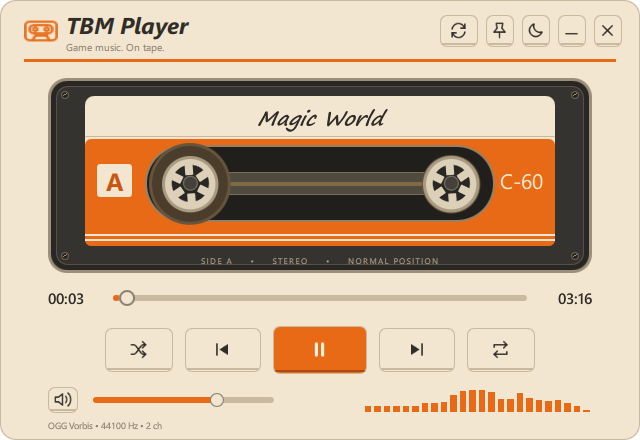
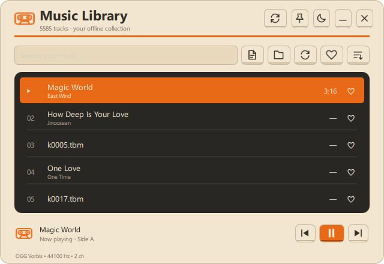

# TBM Cassette Player

Ứng dụng desktop **Python + PySide6 + QML/Qt Quick**, phát TBM/ABM offline bằng
Qt Multimedia. Hai mặt Player/Library nằm trong cùng cửa sổ cassette 640 × 440,
lật 180° trong 400 ms; player âm thanh tồn tại độc lập với giao diện.




## Chạy bản cassette

Yêu cầu Python **3.12+ 64-bit** trên Windows. Máy phát triển đã kiểm thử với
Python 3.14.7 và PySide6 6.12.0. Không cần cài FFmpeg riêng để nghe hoặc xuất OGG;
Qt Multimedia dùng thư viện FFmpeg đi kèm PySide6.

```powershell
python -m venv .venv
./.venv/Scripts/python.exe -m pip install -r requirements.txt
./.venv/Scripts/python.exe main.py
```

Có thể nhập nhạc và phát ngay từ dòng lệnh:

```powershell
./.venv/Scripts/python.exe main.py --play "C:/My Music/song.tbm"
./.venv/Scripts/python.exe main.py "C:/My Music"
```

Ứng dụng không chứa nhạc mẫu ở chế độ production. Chọn Open files/Open folder
trong Music Library, hoặc kéo thả tệp/thư mục vào cửa sổ. Nhấp đúp bài để phát;
nhấp phải để Play next, Favorite, xuất OGG, mở vị trí tệp hoặc xóa khỏi playlist.
Xóa khỏi playlist chỉ xóa bản ghi SQLite, không xóa tệp nhạc.

Nút ghim bật Always on Top; nút mặt trăng đổi Light/Dark. Minimize thu xuống
taskbar; nhấp phải nút Minimize để ẩn vào system tray. Tray có Show, Play/Pause,
Next và Quit. Close thoát ứng dụng và lưu trạng thái. Lần mở sau nhớ bài/vị trí,
âm lượng và vị trí cửa sổ; nhạc chỉ phát tiếp khi người dùng nhấn Play.

| Phím | Chức năng |
| --- | --- |
| Space | Play/Pause, khi không nhập liệu |
| Ctrl+Right / Ctrl+Left | Bài kế / trước |
| Ctrl+O / Ctrl+Shift+O | Mở tệp / thư mục |
| Tab | Lật cassette, khi không nhập liệu |
| Up / Down | Âm lượng ở mặt Player; điều hướng danh sách ở Library |
| Enter | Phát bài được chọn trong danh sách |
| Media Play/Pause, Next, Previous, Stop | Điều khiển khi cửa sổ nhận phím multimedia |

Shuffle bật/tắt bằng nút hai mũi tên đan chéo ở cả mặt Player và thanh phát nhỏ
trong Library; nút màu cam khi bật. Nếu chưa chọn bài, Play chọn ngẫu nhiên bài
đầu tiên. Next và tự chuyển bài tránh lặp trong cùng lượt, theo danh sách đang
lọc. Hết lượt sẽ dừng khi Repeat tắt; Repeat All bắt đầu lượt mới. Trạng thái
Shuffle được lưu ngay khi bật/tắt. Repeat luân phiên Off → Track → All.
Play next dùng hàng đợi ưu tiên. Previous tua về đầu nếu đã phát hơn 3 giây.
Search hỗ trợ tiếng Việt không dấu. Sort hỗ trợ tên A–Z/Z–A và thời lượng.
Duration được xác định khi giải mã bài, không giải mã cả thư viện khi mở app.
Nếu giải mã hoặc phát âm thanh thất bại, ứng dụng tự bỏ qua và thử bài tiếp theo,
ưu tiên hàng đợi Play next và giữ chế độ Shuffle. Repeat Track không giữ ứng
dụng ở bài lỗi. Mỗi bài lỗi chỉ được thử một lần trong chuỗi chuyển tự động;
khi không còn bài có thể thử, ứng dụng dừng và thông báo, không lặp vô hạn.
Stop hoặc chọn bài thủ công hủy chuyển bài đang chờ; chọn lại bài cho phép thử
giải mã lại. Lỗi xuất OGG chỉ báo lỗi xuất, không tự đổi bài đang phát.
Refresh quét lại nguồn đã nhập; thư mục được quét đệ quy và không theo symlink.

## Kiến trúc và xử lý âm thanh

- `tbm_decoder.py`, `audio_utils.py`: giữ nguyên thuật toán decoder gốc và kiểm
  tra CRC/header/codebook; `app/core/tbm_decoder.py` chỉ là adapter.
- `app/workers/decoder_worker.py`: tiến trình con qua QProcess, đọc/kiểm tra hash,
  giải mã theo yêu cầu. Chuyển bài hủy worker cũ mà không sửa thuật toán.
  Hash xác minh lại sau decode để không cache nội dung đang được game cập nhật.
- `app/core/audio_engine.py`: interface AudioEngine và QtAudioEngine; giữ QBuffer
  sống trong suốt thời gian phát OGG từ RAM. Nếu đọc từ RAM thất bại, thử OGG tạm;
  dọn tệp khi chuyển bài/đóng. Có thể thay backend mà không sửa QML.
- `app/core/audio_cache.py`: LRU giới hạn **96 MiB** dữ liệu OGG, không gồm bộ nhớ
  Qt, audio buffer hiện tại và bộ nhớ tạm trong lúc decode.
- `app/core/audio_analyzer.py`: FFT 512 mẫu từ PCM thật qua QAudioBufferOutput,
  24 dải logarit, tối đa 30 lần/giây. Pause/Stop hoặc ẩn mặt Player dừng phân tích.
  Nếu backend không cấp PCM, spectrum giữ mức 0; không tạo tín hiệu giả.
- `app/models/playlist_model.py`: QAbstractListModel và proxy search/sort/filter;
  QML ListView tái sử dụng delegate cho thư viện hàng nghìn bài.
- `app/services/`: SQLite, QSettings, quản lý thư viện và vòng đời playback.
- `app/viewmodels/`: QObject/Signal/Slot/Property nối Python và QML.
- `ui/`: Theme singleton, hai page và các component dùng lại. Các reel dùng
  RotationAnimation có pause/resume từ góc hiện tại; hai mặt không bị tạo lại.

Dữ liệu/log nằm trong thư mục AppLocalData do Qt xác định (`library.sqlite3`,
`player.log`); cấu hình lưu qua QSettings. Không hardcode đường dẫn game.
Không có HTTP server, WebView, Electron hay kết nối mạng trong ứng dụng.

## Kiểm thử

```powershell
# Toàn bộ test mới và hồi quy cho player cũ
./.venv/Scripts/python.exe -m unittest discover -s tests -v

# Thêm bài tích hợp với một tệp TBM thật của bạn
$env:TBM_TEST_FILE = "C:/My Music/song.tbm"
./.venv/Scripts/python.exe -m unittest discover -s tests -v

# Khởi động GUI rồi tự thoát; --play kiểm tra thêm PCM thật trong 10 giây
./.venv/Scripts/python.exe main.py --smoke-test
./.venv/Scripts/python.exe main.py --smoke-test --play "C:/My Music/song.tbm"

# Đo CPU/RAM, quét thư viện, chuyển bài/lật mặt; dữ liệu test được tách riêng
./.venv/Scripts/python.exe scripts/benchmark_cassette.py "C:/My Music"
```

Bài tích hợp TBM thật tự skip nếu chưa đặt `TBM_TEST_FILE`. Benchmark dùng SQLite
và settings tạm, ghi kết quả vào `work/benchmark.json` và ảnh vào `docs/screenshots`.
Xem [báo cáo kiểm thử](docs/TEST_REPORT.md) để biết phạm vi xác minh và giới hạn.

## Đóng gói Windows EXE

```powershell
./.venv/Scripts/python.exe -m pip install -r requirements-build.txt
./build-cassette.ps1
```

Chạy `dist/TBMCassettePlayer/TBMCassettePlayer.exe`. Phân phối **toàn bộ thư mục**
`TBMCassettePlayer`, không tách EXE khỏi `_internal`. Dùng onedir để tránh giải nén
Qt mỗi lần mở hoặc tạo decoder worker. Hook trong `packaging/hooks` chỉ thu thập
module QML cần dùng, bỏ WebEngine/Qt Quick 3D và các style không sử dụng.

Decoder cần hai sidecar `vorbis_templates.json`, `song_metadata.json`; script đã
đóng gói sẵn. Khi đổi PySide6, phải chạy lại smoke test EXE và kiểm tra giấy phép
Qt/FFmpeg/PyCryptodome trước khi phân phối. Không cần cài Python ở máy nhận.

## Giới hạn kỹ thuật

- Decoder chỉ nhận các biến thể/codebook mà thuật toán hiện có hỗ trợ; tệp lạ
  được báo lỗi, không đoán header và không sửa tệp gốc.
- AudioEngine có interface thay thế, chưa tích hợp backend libmpv.
- Bản cassette xuất OGG Vorbis nguyên bản; bản Tkinter cũ bên dưới vẫn có xuất
  MP3/WAV qua FFmpeg. Spectrum cần backend FFmpeg của Qt ≥ 6.8.
- Phím multimedia dùng Qt shortcuts trong cửa sổ ứng dụng; chưa đăng ký hotkey
  toàn hệ thống. Tray menu có thể điều khiển khi cửa sổ bị ẩn.
- Refresh do người dùng kích hoạt; không theo dõi thay đổi thư mục liên tục.
- Bo góc dùng cửa sổ trong suốt; khu vực ngoài góc vẫn thuộc bounds cửa sổ native.
- Các kiểm thử tự động không thay thế việc nghe âm thanh, kiểm tra nhiều thiết bị
  output, DPI khác nhau và chạy soak test lâu dài trên máy Windows sạch.

---

# Tài liệu bản Tkinter trước đây

`player.py`, `build.ps1`, `TBMPlayer-Offline.spec` và các tệp EXE cũ được giữ nguyên.
Phần dưới áp dụng cho **bản Tkinter cũ**, không phải entry point `main.py` mới.

## Audition Music Player

Trình phát nhạc Audition offline cho Windows: nghe trực tiếp từ file **TBM/ABM**, tìm tên bài và ca sĩ, xuất **MP3, OGG hoặc WAV** mà không cần mở game.

## Chức năng

- Thư viện nhạc với tên bài, ca sĩ, tên file, ngày sửa đổi và dung lượng.
- Tìm kiếm theo tên bài có/không dấu, ca sĩ hoặc tên file; nhấn **Ctrl+F** để tìm nhanh.
- Phát, tạm dừng, tiếp tục, dừng, bài trước/bài sau và tự chuyển bài khi hết.
- Đĩa nhạc quay khi đang phát, đứng yên khi tạm dừng hoặc dừng.
- Tự nhận file nhạc thêm/xóa/cập nhật trong thư mục mỗi 3 giây; chỉ giải mã khi nghe hoặc xuất.
- Bài chưa có tên/ca sĩ sẽ hiển thị tên file.

## Chuẩn bị

| Thành phần | Khi nào cần? |
| --- | --- |
| Máy Windows có giao diện desktop | Phát nhạc dùng Windows MCI; chưa hỗ trợ Linux/macOS |
| Python 3.14 64-bit, có pip và Tkinter | Chạy từ mã nguồn; đây là phiên bản đã kiểm tra |
| FFmpeg cho Windows | Nghe nhạc và xuất MP3/WAV; xuất OGG không cần FFmpeg |
| File nhạc `.tbm` hoặc `.abm` trên máy | Chương trình không tải nhạc |

Repository cung cấp mã nguồn và dữ liệu hỗ trợ. File nhạc/game và FFmpeg không đi kèm. Hướng dẫn bên dưới áp dụng cho mọi thư mục cài đặt, không yêu cầu có ổ D hoặc E.

## 1. Cài Python

Tải Python 3.14 64-bit từ [trang Python cho Windows](https://www.python.org/downloads/windows/). Chọn bộ cài thông thường có pip và Tcl/Tk, không chọn bản *embeddable*.

Sau khi cài, mở PowerShell hoặc Windows Terminal và kiểm tra:

```powershell
py -3.14 --version
```

Nếu máy không nhận lệnh `py`, thử `python --version`. Nếu lệnh này trả về Python 3.14, có thể dùng `python` thay cho `py -3.14` trong bước tạo môi trường bên dưới. Xem [hướng dẫn Python trên Windows](https://docs.python.org/3.14/using/windows.html) nếu cả hai lệnh đều chưa hoạt động.

## 2. Tải mã nguồn

**Không dùng Git:** [tải mã nguồn ZIP](https://github.com/cuongga1504/audition-music-player/archive/refs/heads/main.zip), giải nén vào một thư mục trên máy, rồi mở Terminal/PowerShell tại thư mục chứa `player.py` và `requirements.txt`.

**Nếu đã cài Git:**

```powershell
git clone https://github.com/cuongga1504/audition-music-player.git
cd audition-music-player
```

## 3. Cài thư viện và mở chương trình

Chạy các lệnh sau trong thư mục mã nguồn:

```powershell
py -3.14 -m venv .venv
.\.venv\Scripts\python.exe -m pip install -r requirements.txt
.\.venv\Scripts\python.exe player.py
```

Các lệnh dùng trực tiếp Python trong `.venv`, nên không cần kích hoạt môi trường bằng `Activate.ps1`.

Những lần sau chỉ cần mở Terminal tại thư mục này và chạy:

```powershell
.\.venv\Scripts\python.exe player.py
```

## 4. Cài và chọn FFmpeg

1. Mở [trang tải FFmpeg](https://ffmpeg.org/download.html), tìm mục **Windows EXE Files** và chọn một bản build cho Windows.
2. Giải nén file tải về, tìm `ffmpeg.exe` trong thư mục `bin`.
3. Trong trình phát, bấm **Chọn FFmpeg…** và chọn file `ffmpeg.exe` đó.

Để chương trình tự tìm FFmpeg ở những lần mở sau, có thể đặt `ffmpeg.exe` cạnh `player.py` khi chạy mã nguồn, hoặc cạnh `TBMPlayer-Offline.exe` khi chạy bản đã build. Chương trình cũng tìm trong PATH, `C:\ffmpeg\bin` và `D:\Audition\ffmpeg64.exe` nếu có.

Không cần cài Python khi chạy EXE đã build; vẫn cần FFmpeg để nghe hoặc xuất MP3/WAV.

## 5. Nghe nhạc và xuất file

1. Bấm **Mở thư mục…**, chọn thư mục chứa các file `.tbm`/`.abm`. Ví dụ thư mục `abm` trong nơi bạn cài Audition. Hoặc bấm **Mở tệp…** để chọn một bài.
2. Chọn bài rồi bấm **Nghe**, hoặc nhấp đúp vào bài đó.
3. Dùng **Tạm dừng / Tiếp tục / Dừng / Bài trước / Bài sau** để điều khiển.
4. Bật **Tự chuyển bài khi hết** để nghe tiếp theo thứ tự danh sách đang hiển thị, bao gồm kết quả tìm kiếm. Hết bài cuối thì dừng.
5. Chọn bài cần xuất, bấm **Xuất MP3…** hoặc **Lưu OGG / WAV…**, rồi chọn nơi lưu và định dạng phù hợp.

Chương trình không ghi đè file đã có. Hãy chọn tên mới nếu file đích đã tồn tại.

Nếu `D:\Audition\abm` tồn tại, chương trình tự mở thư mục này lúc khởi động. Đây chỉ là vị trí mặc định; bạn có thể chọn thư mục ở bất kỳ ổ đĩa nào. Cột **Ngày sửa đổi** hiển thị giờ Việt Nam (UTC+7).

## Xuất bằng dòng lệnh

Chạy trong thư mục mã nguồn. Thay đường dẫn đầu vào bằng file có thật trên máy; tạo thư mục đầu ra trước khi xuất:

```powershell
New-Item -ItemType Directory -Force .\exports
.\.venv\Scripts\python.exe player.py "E:\Music\song.tbm" --export ".\exports\song.mp3"
.\.venv\Scripts\python.exe player.py "E:\Music\song.tbm" --export ".\exports\song.ogg" --report ".\exports\song-receipt.json"
```

Lệnh xuất OGG không cần FFmpeg. File âm thanh và file báo cáo phải là file mới. EXE đã build cũng hỗ trợ cùng các tham số `--export` và `--report`.

## Tự build EXE

Sau khi hoàn tất bước cài từ mã nguồn:

```powershell
.\.venv\Scripts\python.exe -m pip install -r requirements-build.txt
.\build.ps1 -Python .\.venv\Scripts\python.exe
```

Nếu PowerShell không cho chạy script, có thể gọi trực tiếp PyInstaller:

```powershell
.\.venv\Scripts\python.exe -m PyInstaller --noconfirm --clean --onefile --windowed --name TBMPlayer-Offline --add-data "vorbis_templates.json;." --add-data "song_metadata.json;." player.py
```

File chương trình nằm tại **`dist/TBMPlayer-Offline.exe`**. Có thể chép EXE sang thư mục khác và chạy trực tiếp. FFmpeg không được đóng gói trong EXE; đặt `ffmpeg.exe` cạnh EXE hoặc dùng nút **Chọn FFmpeg…**.

## Cập nhật tên bài và ca sĩ

Bảng đi kèm có 852 mã file trích từ dữ liệu game cũ, chưa bao phủ toàn bộ thư viện. File chưa tìm được thông tin sẽ hiển thị tên file; không đoán tên từ mã gần giống.

Bảng `song_metadata.json` được đọc khi mở chương trình. Bản EXE có sẵn bảng này bên trong; nếu có `song_metadata.json` bên cạnh EXE, bảng bên ngoài được ưu tiên. Khi cập nhật bảng, hãy đóng rồi mở lại chương trình.

Thông tin được ghép theo **tên file đầy đủ**, bao gồm phần mở rộng, không phân biệt chữ hoa/thường. Ví dụ một file JSON tối thiểu:

```json
{
  "tracks": {
    "song.tbm": {
      "title": "Tên bài hát",
      "artist": "Tên ca sĩ"
    }
  }
}
```

## Lỗi thường gặp

| Hiện tượng | Cách xử lý |
| --- | --- |
| Không nhận `py` hoặc `python` | Kiểm tra lại việc cài Python theo bước 1, rồi mở cửa sổ Terminal mới |
| `No module named Crypto` | Chạy lại lệnh cài `requirements.txt` bằng `.\.venv\Scripts\python.exe` |
| `No module named tkinter` | Dùng bộ cài Python thông thường có Tcl/Tk và tạo lại môi trường `.venv` |
| Chưa tìm thấy FFmpeg | Bấm **Chọn FFmpeg…** và chọn đúng `ffmpeg.exe`; không chọn file ZIP hoặc thư mục |
| Danh sách trống | Chọn đúng thư mục chứa `.tbm`/`.abm`; danh sách đọc file trực tiếp trong thư mục đã chọn, không quét thư mục con |
| Chưa có mẫu codebook Vorbis khớp bài | Biến thể/header của bài chưa được hỗ trợ; cài FFmpeg không khắc phục lỗi này |
| Báo sai checksum, CRC hoặc thiếu dữ liệu | Chờ game cập nhật file xong rồi thử lại; file vẫn lỗi có thể bị hỏng hoặc thuộc biến thể chưa hỗ trợ |
| Không xuất được vì file đã tồn tại | Chọn tên hoặc vị trí đầu ra khác |

## Giới hạn

- Chưa hỗ trợ mọi biến thể TBM/ABM hoặc codebook Vorbis. File không đủ dữ liệu hoặc không xác định được header sẽ bị từ chối.
- Bảng tên bài là dữ liệu cũ; không có thông tin tên cho mọi bài mới.
- Header OGG được khôi phục, các trang âm thanh sau header được giữ nguyên. Không khẳng định file xuất giống từng byte với OGG gốc trước khi game đóng gói.
- MP3 là bản chuyển mã có mất dữ liệu. Chọn OGG để giữ các trang âm thanh nén sau giải mã.
- Giới hạn đầu vào và luồng OGG: 64 MiB.

## Kiểm tra cho người phát triển

Chạy trên Windows có phiên desktop để Tkinter hoạt động:

```powershell
.\.venv\Scripts\python.exe -m unittest discover -s tests -v
```

13 kiểm tra bao gồm tự chuyển bài, cập nhật thư mục, thao tác dừng và cache theo phiên bản file. Phạm vi kiểm tra file nhạc thật, bố cục và hoạt ảnh được ghi trong [VALIDATION.txt](VALIDATION.txt).

## Mã nguồn và ghi nhận

| File | Vai trò |
| --- | --- |
| `player.py` | Giao diện, Windows MCI, thư viện và dòng lệnh |
| `tbm_decoder.py` | Đọc TBM/ABM và khôi phục header Vorbis |
| `audio_utils.py` | Kiểm tra OGG và xuất âm thanh bằng FFmpeg |
| `song_metadata.json` | Ghép tên file với tên bài và ca sĩ |
| `vorbis_templates.json` | Mẫu header/codebook và bảng hoán vị |
| `tests/test_player.py` | Kiểm tra tự chuyển bài và cập nhật thư viện |

Lịch sử thay đổi: [CHANGELOG.txt](CHANGELOG.txt). Nguồn thuật toán và dữ liệu tham khảo: [THIRD-PARTY-NOTICES.txt](THIRD-PARTY-NOTICES.txt). Giấy phép thư viện PyCryptodome: [PyCryptodome-LICENSE.txt](PyCryptodome-LICENSE.txt).
